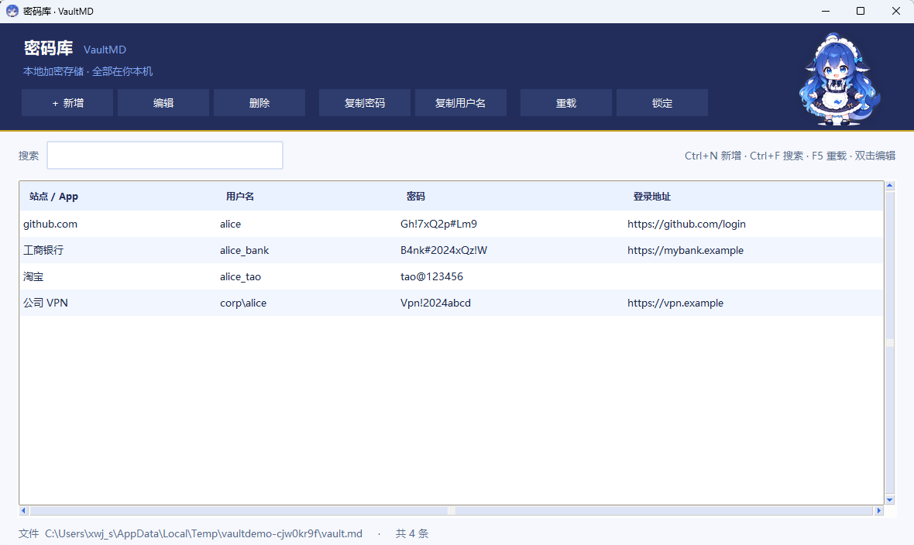
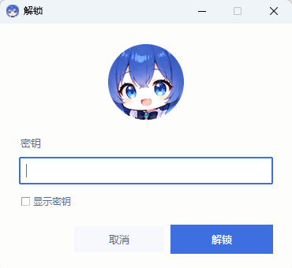
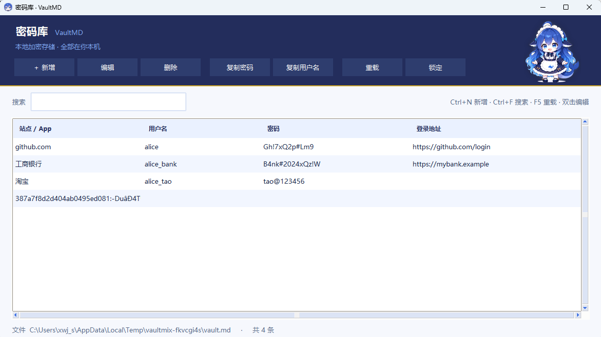

# VaultMD · Local Password Vault

A tiny local tool that keeps every website password in one table. The whole vault is a
fully encrypted markdown file locked behind a single passphrase. No account, no cloud,
no backend — everything stays on your machine.

**English** · [简体中文](README.zh-CN.md)



> **This repository ships source code only — no prebuilt executables.**
> Run it from source (see [Quick start](#3-quick-start)), or build it yourself
> with `python build.py`.

---

## 0. Mascot

**Big blue fish**



Resize the window and she swaps to a larger artwork automatically
(128 → 176 → 200 → 260 → 320 → 380 px, one step at a time).

> **Artwork credit**
> DeepSeek maid redesign: **ZipZipPipe** — bilibili `space.bilibili.com/4168597`
> Chibi reference sheet compiled by the open whale-girl asset library · **TreapGoGo**
> (`treapgogo.github.io/deepseek-whale-girl`)
> Reference page: <https://genderswapai.com/zh-CN/ai-gijinka/deepseek/chibi>
>
> The `assets/deepseek-*.png` files were downloaded from that reference page and are used
> purely as decoration in a personal local tool. Redistribution or derivative works must
> follow the terms on the source page and keep the attribution above.
> If you fork this project, verify the licensing yourself.

---

## 1. What problem it solves

Every site has its own password rules — some demand uppercase, some demand symbols, some
cap the length. And unless you click "reset password", you usually have no idea what the
rules even are.

How VaultMD handles it:

- one `vault.md` holds every site, username, password and login URL;
- **one line per record, one ciphertext per line** — nothing on disk is plaintext;
- type your passphrase on launch, and each line is decrypted independently and shown as-is;
- different lines can be encrypted under different passphrases: open with `key a` and the
  lines encrypted under `a` are readable while the lines under `key b` are garbage, and
  vice versa.

---

## 2. How it works

### 2.1 Storage format: one line = one record = one ciphertext

`vault_data/vault.md` looks like this:

```
# VPMD/2
# one line = one encrypted record. nothing else is stored in plaintext.

5NyrVOxRoPLnAzKw6jW/Pg==.6a4q7StEVBXBuHiS.4A8tq+avTRWXHIYUkp7bHWmiP+XOr6as...
v2ID5r5qsPdxPu8ivZknWg==.9z5SdE6189urfNUx.iNGqS...
```

- each line is `base64(salt).base64(nonce).base64(body)`, three fields separated by `.`;
- one line is one record, and **lines are fully independent** — each has its own salt,
  its own nonce, and its own derived key;
- the file contains only two `#` format lines (no user data at all). Site names, usernames,
  passwords and URLs all live inside ciphertext, so the file is free of plaintext and you
  cannot `grep` it to discover which services you use;
- inside a record the payload is `VPMD2<US>k=v<US>...` with every field base64-encoded
  again, so a site name containing newlines, `=`, `.` — even the field separator — cannot
  break the one-line-per-record structure.

### 2.2 Cryptography

| Item | Value |
|---|---|
| KDF | scrypt, N=2^15, r=8, p=1 |
| Cipher | AES-256-GCM |
| salt | per line, random 16 bytes |
| nonce | per line, random 12 bytes |

GCM authenticates the ciphertext; flipping a single bit makes it undecryptable. That is a
feature, not a bug — see the next section for what happens when it fails.

### 2.3 No passphrase validation

The program stores no key material. It always decrypts with whatever you typed at launch,
and that input **never produces an error**:

- correct passphrase → normal plaintext
- wrong passphrase → garbage

> Lines 1–10 encrypted with `a`, lines 11–20 encrypted with `b`.
> Enter `a` → the first ten lines are readable and the last ten are garbage; enter `b` → the reverse.



### 2.4 A protection you should know about

Open with `a`, add a new line, save — the lines encrypted under `b` are **not** rewritten
as garbage ciphertext. Undecryptable lines are written back verbatim (the original
`salt.nonce.body`), and only lines created or edited in the current session get re-encrypted
with the session passphrase.
(`test_vault.py` has a dedicated case guarding this: `b lines are not damaged`.)

---

## 3. Quick start

### 3.1 Run from source

Requires Python 3.10+.

```powershell
python -m pip install -r requirements.txt
python vault_app.py
```

First run:

1. the **Unlock** window appears (it is the only window on screen);
2. type a passphrase and press Enter;
3. the main window opens with an empty table (no entries yet);
4. click **＋ New (Ctrl+N)** and fill in site, username, password — the password can be
   generated from a rule template in one click;
5. click **Save** → written to `vault_data/vault.md`.

Next time, enter the same passphrase and every entry is there.

Clicking **Cancel** in the unlock window exits the program.

### 3.2 UI reference

The main window has four bands: a dark navy header (title + toolbar + mascot), a search row,
the table card, and a status bar.

| Element | Function |
|---|---|
| New / Edit / Delete | Add, modify, remove entries; double-click a row to edit, Delete key to remove |
| Copy password / Copy username | Writes to clipboard, auto-cleared after 30 s by default; Ctrl+C also copies the password |
| Reload (F5) | Re-read from disk — handy after the vault file was touched by git or a sync tool |
| Lock | Wipes the in-memory passphrase, **hides the main window** and re-opens the unlock dialog |
| Search (Ctrl+F) | Fuzzy search across all four fields |

The table has exactly four columns: **site / app, username, password, login URL**, with
alternating light-blue rows. The password column shows **plaintext directly** (no masking).
There is no export feature at all — to back up, copy `vault.md` itself; it is always ciphertext.

### 3.3 Password rule templates

`vault_data/config.json` ships with four presets; add or remove your own:

```json
"policies": {
  "默认(强)":            {"length": 20, "upper": true, "lower": true, "digits": true, "symbols": true},
  "兼容老站(无特殊字符)": {"length": 16, "upper": true, "lower": true, "digits": true, "symbols": false},
  "纯数字PIN":           {"length": 6,  "upper": false, "lower": false, "digits": true, "symbols": false},
  "银行/金融(24位)":     {"length": 24, "symbols_set": "!@#$%^&*"}
}
```

The generator guarantees at least one character from every enabled class, so rules like
"must contain upper, lower, digit and symbol" are satisfied on the first try.

---

## 4. File layout

```
password_vault/
├── vault_app.py         GUI (unlock window / main window / editor window)
├── vault_theme.py       Colors, fonts, ttk styles, mascot asset loading
├── vault_crypto.py      Line-level encryption + record serialization + password generator
├── vault_store.py       Disk I/O, atomic save, config
├── migrate_v1_to_v2.py  Legacy block format -> line format
├── make_assets.py       Artwork background removal / resizing / icon generation
├── build.py             PyInstaller build script
├── test_vault.py        End-to-end tests (36 cases, incl. mixed-passphrase scenarios)
├── smoke_gui.py         GUI smoke test (really creates a window and drives it)
├── exe_selftest.py      End-to-end self-check of a packaged build
├── shot_tool.py         Window-only screenshot helper
├── demo_shot.py         Renders the main-window screenshot _demo.png
├── demo_mixed.py        Renders the mixed-passphrase screenshot _demo_mixed.png
├── demo_unlock.py       Renders the unlock-window screenshot _demo_unlock.png
├── crop_shot.py         Small screenshot cropping utility
├── verify_unlock_only.py Verifies "only the unlock window is shown at launch"
├── assets/
│   ├── deepseek-front/side/back.png   Original reference three-view
│   ├── mika_128..380.png              Cut-out, brightened, haloed artwork
│   ├── mika_head.png                  Circular avatar (eye line centered)
│   └── app_icon.ico/.png              Window and taskbar icons
├── vault_data/          Created at runtime, never committed
│   ├── vault.md         The one and only vault file (no copies are ever made)
│   └── config.json
├── requirements.txt     Runtime dependency (cryptography)
├── README.md            English (default)
└── README.zh-CN.md      简体中文
```

---

## 5. Tests and screenshots

```powershell
python vault_crypto.py        # crypto layer self-check
python test_vault.py          # 36 end-to-end cases
python smoke_gui.py           # GUI smoke test (opens a real window, drives it, closes itself)
python verify_unlock_only.py  # verifies only the unlock window appears at launch
python demo_shot.py           # renders _demo.png
python demo_mixed.py          # renders _demo_mixed.png
python demo_unlock.py         # renders _demo_unlock.png
python make_assets.py         # regenerates the mascot assets
```

`test_vault.py` covers: no plaintext on disk, the one-line-per-record structure, correct
passphrase round-trip, awkward characters (newlines / separators / equals signs),
deterministic garbage under a wrong passphrase, **garbage lines carry no hint text**,
line-level mixed passphrases being mutually unreadable, saving with a wrong passphrase not
damaging other lines, empty file, comments only, corrupt lines (also rendered as garbage),
hand-made junk files, **no plaintext export path exists**, **no automatic backup exists**,
and 200-run generator compliance.

`smoke_gui.py` guards the UI layer: **the main window must be withdrawn during unlock**,
restored afterwards, the table has exactly 4 columns, no note column, no status column,
no export button in the toolbar, the status bar never says "readable / garbage", and when
opened with the wrong passphrase no row contains any hint wording.

### About screenshots

Every `demo_*.py` goes through `shot_tool.grab_with_titlebar()`, which computes the window
rectangle from `winfo_rootx/rooty/width/height` and captures **only the application window** —
desktop, taskbar and other windows never enter the image.
Do not switch back to full-screen capture: that leaks the user's desktop into the README.

---

## 6. Building it yourself

```powershell
python -m pip install pyinstaller
python build.py              # onedir (default) -> dist/VaultMD/VaultMD.exe
python build.py --onefile    # single file      -> dist/VaultMD.exe
```

**The default is the onedir build**, because the onefile build has to unpack itself into
`%TEMP%\_MEIxxxxxx` on every launch. That step is frequently blocked by antivirus,
endpoint protection, group policy or restricted accounts, failing with:

```
[PYI-000000:ERROR] Could not create temporary directory!
```

The onedir build does no self-extraction and never writes to the temp directory, so it is
far more compatible.

| Item | onedir location | onefile location |
|---|---|---|
| Program | `dist/VaultMD/VaultMD.exe` | `dist/VaultMD.exe` |
| Dependency DLLs | `dist/VaultMD/_internal/` | embedded in the exe |
| Mascot assets | `_internal/assets/` | unpacked to `%TEMP%` |
| `vault.md` data | **next to the exe** `vault_data/` | **next to the exe** `vault_data/` |

The data directory always follows the executable and never lands in `%TEMP%` —
`vault_store._app_dir()` checks `sys.frozen` and, when frozen, uses the parent directory of
`sys.executable`. (`__file__` cannot be used: under onefile it points into the temporary
unpack directory and the data would vanish when the program exits.)

### 6.1 Verifying a build

```powershell
python exe_selftest.py dist/VaultMD/VaultMD.exe
```

It copies the whole directory to a clean location and runs
`VaultMD.exe --selfcheck`, a headless self-test checking that assets load, encryption
round-trips, a wrong passphrase merely yields garbage, and no plaintext reaches disk.

---

## 7. Why there is no prebuilt exe

This repository ships source only and publishes no prebuilt executables.

---

## 8. Security boundaries

1. **Forgetting the passphrase means permanent data loss.**
2. **Multiple passphrases means remembering every one of them.**
3. **No validation means a single typo is invisible on screen.**
4. **Do not casually delete garbage lines.** A line may well be real data encrypted under a
   different passphrase; the UI deliberately won't tell you, so try a few passphrases before deleting.
5. **Backups are manual only.**
6. **The threat model is "someone else can read the file on disk".**

---

## 9. License

The source code may be used, modified and distributed freely.
Derivative works must keep the artwork attribution from section 0.
