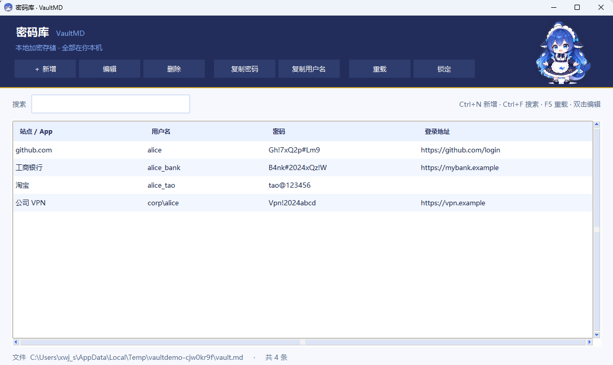
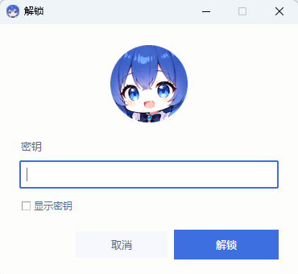
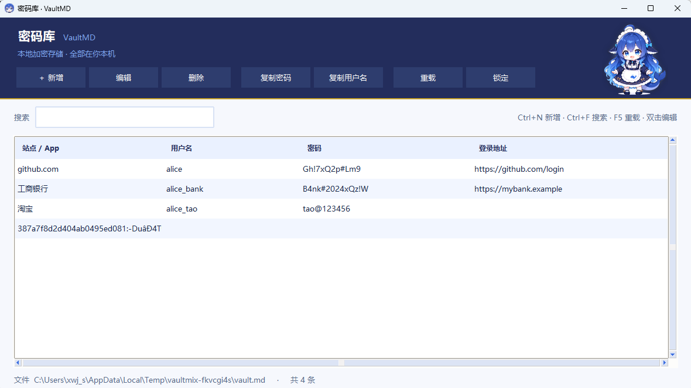

# VaultMD · 本地密码库

一个只用键盘和一张表格管住所有网站密码的小工具。整个库是一个全加密的 markdown 文件，
锁在一把你自己的密钥后面。没有账号、没有云、没有后端，全部在你本机。

[English](README.md) · [简体中文](README.zh-CN.md)



> **本仓库不提供预编译的可执行文件。**
> 请按下文「快速开始」自行运行源码，或用 `python build.py` 在本机构建。

---

## 0. 看板娘

**蓝色大肥鱼**



窗口拉大时她会自动换更大的立绘（128 → 176 → 200 → 260 → 320 → 380 px 逐档上升）。

> **形象来源与署名**
> DeepSeek 女仆形象改编：**ZipZipPipe**（space.bilibili.com/4168597）；
> Q 版设定图整理：鲸鱼娘开源资产库 · **TreapGoGo**
> （treapgogo.github.io/deepseek-whale-girl）；
> 参考页：<https://genderswapai.com/zh-CN/ai-gijinka/deepseek/chibi>
>
> 本仓库内的 `assets/deepseek-*.png` 是从上述参考页下载的原始立绘，
> 仅用于个人本地工具的界面装饰。二创 / 分发请遵守来源页的使用条件并保留署名。
> 如果你要 fork 后用在自己项目里，请自行确认授权。

---

## 1. 它解决什么问题

每个站点的密码规则都不一样（有的大小写、有的要特殊字符、有的限长度），最重要的是，你除非点击重置密码，否则根本不知道它究竟有哪些规则

VaultMD 的做法：

- 一个 `vault.md` 装下所有站点、用户名、密码、登录地址；
- **一行一条记录、一行一份独立密文**，整个文件在磁盘上没有任何明文；
- 打开时输入密钥，逐行解密后直接显示明文；
- 不同行可以用不同密钥加密：输 `密钥a` 时 `密钥a` 的行可读、`密钥b` 的行是乱码，反之亦然。

---

## 2. 工作原理

### 2.1 存储格式：一行 = 一条记录 = 一份独立密文

`vault_data/vault.md` 长这样：

```
# VPMD/2
# one line = one encrypted record. nothing else is stored in plaintext.

5NyrVOxRoPLnAzKw6jW/Pg==.6a4q7StEVBXBuHiS.4A8tq+avTRWXHIYUkp7bHWmiP+XOr6as...
v2ID5r5qsPdxPu8ivZknWg==.9z5SdE6189urfNUx.iNGqS...
```

- 每行是 `base64(salt).base64(nonce).base64(body)`，三段用 `.` 分隔；
- 一行就是一条记录，**行与行互相独立**：各自一份 salt、一份 nonce、各自派生密钥；
- 文件里只有两行 `#` 开头的格式标识（不含任何用户数据），
  站名、用户名、密码、登录地址全部在密文里 —— 整个 md 无明文，也无法 `grep`
  出你在用哪些服务；
- 记录内部用 `VPMD2<US>k=v<US>...` 编码，每个字段再 base64，
  所以站点名里写换行、`=`、`.` 甚至分隔符都不会撞坏"一行一条"的结构。

### 2.2 加解密

| 项 | 取值 |
|---|---|
| KDF | scrypt，N=2^15, r=8, p=1 |
| 加密 | AES-256-GCM |
| salt | 每行独立随机 16 字节 |
| nonce | 每行独立随机 12 字节 |

GCM 自带完整性校验，密文被改一位就解不开 —— 这是特性不是 bug，
解不开时按下节处理。

### 2.3 不做密钥校验

本程序不存储任何密钥，每次均使用打开程序时输入的密钥做解密，输入的密钥**永远不报错**：
- 密钥正确 → 正常明文
- 密钥错误 → 乱码

> 第 1–10 行用密钥 `a` 加密，第 11–20 行用密钥 `b` 加密。
> 输入 `a` → 前 10 行正常文字，后 10 行乱码；输入 `b` → 反过来。




### 2.4 一个必须知道的保护

用密钥 `a` 打开、加了新行、保存 —— **不会**把 `b` 加密的那些行重新写成乱码密文。
实现上：解不开的行保留它原来那一整行密文（`salt.nonce.body`）原样回写，
只有「本次会话新增/改过」的行才会用当前密钥重新加密。
（`test_vault.py` 里有专门的用例守着这条：`b的行没被破坏`。）


## 3. 快速开始

### 3.1 源码运行

需要 Python 3.10+：

```powershell
python -m pip install -r requirements.txt
python vault_app.py
```

首次运行：

1. 弹「解锁」窗
2. 输入密钥，回车；
3. 主界面出现，表格是空的（还没有条目）；
4. 点「＋ 新增 (Ctrl+N)」填站点、用户名、密码 —— 密码可以用规则模板一键生成；
5. 点「保存」→ 写入 `vault_data/vault.md`。

之后再打开，输入同一个密钥就能看到所有条目。

解锁窗里点「取消」= 直接退出程序。

### 3.2 界面元素

主窗分四块：顶部深蓝栏（标题 + 工具栏 + 看板娘）、搜索行、表格卡片、状态栏。

| 位置 | 功能 |
|---|---|
| 新增 / 编辑 / 删除 | 条目增删改；双击行 = 编辑，Delete 键 = 删除 |
| 复制密码 / 复制用户名 | 写进剪贴板，默认 30 秒后自动清空；Ctrl+C 也可直接复制密码 |
| 重载 (F5) | 从磁盘重读，适合库文件被 git/同步工具更新过 |
| 锁定 | 清掉内存里的密钥，**藏起主窗**并重新弹解锁框 |
| 搜索 (Ctrl+F) | 在四个字段里模糊搜 |

表格只有四列：**站点 / App、用户名、密码、登录地址**，隔行浅蓝斑马纹。
密码列**直接显示明文**（不做掩码）。程序里没有任何"导出"功能 ——
要备份就复制 `vault.md` 本身，它永远是密文。

### 3.3 密码规则模板

`vault_data/config.json` 里预置了 4 条，可自行增删：

```json
"policies": {
  "默认(强)":            {"length": 20, "upper": true, "lower": true, "digits": true, "symbols": true},
  "兼容老站(无特殊字符)": {"length": 16, "upper": true, "lower": true, "digits": true, "symbols": false},
  "纯数字PIN":           {"length": 6,  "upper": false, "lower": false, "digits": true, "symbols": false},
  "银行/金融(24位)":     {"length": 24, "symbols_set": "!@#$%^&*"}
}
```

生成器保证「每类各至少 1 个字符」，所以"必须有大小写+数字+特殊字符"这类规则一次过。

---

## 4. 文件布局

```
password_vault/
├── vault_app.py         GUI 主程序（解锁窗 / 主窗 / 编辑窗）
├── vault_theme.py       配色、字体、ttk 样式、看板娘素材加载
├── vault_crypto.py      行级加解密 + 记录序列化 + 密码生成器
├── vault_store.py       磁盘读写、原子保存、config
├── migrate_v1_to_v2.py  旧版块式数据 -> 行式数据
├── make_assets.py       立绘去白底 / 缩放 / 生成图标（改形象时用）
├── build.py             PyInstaller 打包脚本
├── test_vault.py        端到端测试（36 项，含行级混合密钥场景）
├── smoke_gui.py         GUI 冒烟测试（真建窗口自动跑流程）
├── exe_selftest.py      对打包产物做端到端自检
├── demo_shot.py         生成主窗截图 _demo.png
├── demo_mixed.py        生成混合密钥截图 _demo_mixed.png
├── demo_unlock.py       生成解锁窗截图 _demo_unlock.png
├── crop_shot.py         截图裁切小工具
├── verify_unlock_only.py 验证"启动时只有解锁窗"
├── assets/
│   ├── deepseek-front/side/back.png   原设定三视图（下载自参考页）
│   ├── mika_128..380.png              去白底 + 提亮 + 光晕后的立绘
│   ├── mika_head.png    圆形头像（眼睛连线居中）
│   └── app_icon.ico/.png  窗口与任务栏图标
├── vault_data/          运行时生成，不入库
│   ├── vault.md         唯一的库文件（程序不产生任何副本）
│   └── config.json
├── requirements.txt     运行依赖（cryptography）
├── README.md            English（默认）
└── README.zh-CN.md      简体中文
```

---

## 5. 测试与截图

```powershell
python vault_crypto.py      # 加密层自检
python test_vault.py        # 端到端 36 项
python smoke_gui.py         # GUI 冒烟（会真的开一个窗口，自动跑完自己关）
python verify_unlock_only.py  # 验证启动时只有解锁窗
python demo_shot.py         # 生成 _demo.png
python demo_mixed.py        # 生成 _demo_mixed.png
python demo_unlock.py       # 生成 _demo_unlock.png
python make_assets.py       # 重新生成立绘素材
```

`test_vault.py` 覆盖：明文不落盘、一行一条的结构断言、正确密钥往返、
含换行/分隔符/等号的怪字符往返、错密钥确定性乱码、
**乱码行不含任何提示性文字**、行级混合密钥互不可读、用错密钥打开后保存不破坏别的行、
空文件、只有注释、损坏行（也只输出乱码）、手工垃圾文件、
**程序里没有导出明文这条路**、**程序不做任何自动备份**、生成器 200 次合规性。

`smoke_gui.py` 守着界面层：**解锁期间主窗必须是 withdrawn**、解锁后恢复正常、
表格只有 4 列、没有备注列、没有状态列、工具栏没有导出按钮、
状态栏不出现"可读/乱码"字样、用错密钥打开时整行文字里不含任何提示语。

### 截图说明

`demo_*.py` 全部走 `shot_tool.grab_with_titlebar()`：按
`winfo_rootx/rooty/width/height` 算出窗口矩形再截，
**只截应用窗口本身**，桌面、任务栏、其他窗口一律不进图。
不要改回全屏截图 —— 那样会把使用者的桌面内容一起带进 README。

---

## 6. 自行打包

```powershell
python -m pip install pyinstaller
python build.py              # 目录版（默认），产物 dist/VaultMD/VaultMD.exe
python build.py --onefile    # 单文件，产物 dist/VaultMD.exe
```

**默认产出目录版**，因为单文件版启动时要先把自身解包到 `%TEMP%\_MEIxxxxxx`，
这一步常被杀毒软件、终端防护、组策略或受限账户拦截，报错就是：

```
[PYI-000000:ERROR] Could not create temporary directory!
```

目录版不做自解压，运行时不需要写临时目录，兼容性最好。

| 内容 | 目录版位置 | 单文件版位置 |
|---|---|---|
| 程序 | `dist/VaultMD/VaultMD.exe` | `dist/VaultMD.exe` |
| 依赖 DLL | `dist/VaultMD/_internal/` | 打进 exe |
| 看板娘素材 | `_internal/assets/` | 解包到 `%TEMP%` |
| 数据 `vault.md` | **exe 同级** `vault_data/` | **exe 同级** `vault_data/` |

数据目录永远跟着 exe 走，不会落到 `%TEMP%` —— `vault_store._app_dir()` 用
`sys.frozen` 判断，冻结后取 `sys.executable` 的父目录。
（不能用 `__file__`：onefile 下它指向解包临时目录，程序一退出数据就没了。）

### 6.1 验证打包结果

```powershell
python exe_selftest.py dist/VaultMD/VaultMD.exe
```

它会把整个目录拷到干净位置，用 `VaultMD.exe --selfcheck` 跑一遍无界面自检：
素材能否加载、加密能否往返、错密钥是否只是乱码、磁盘上有没有明文。

---

## 7. 为什么不提供 exe

本仓库只放源码，不发预编译的可执行文件。

---

## 8. 安全边界

1. **忘记密钥 = 数据永久丢失。** 
2. **多密钥 = 每个密钥都要记住。** 
3. **不校验密钥 = 敲错一个字符也看不出来。** 
4. **乱码行不要随手删。** 它很可能是用另一个密钥加密的真实数据；
   界面不会告诉你这件事（这是刻意的），所以删之前先换几个密钥试试。
5. **备份只能自己拷。** 
6. **威胁模型是"磁盘文件被别人看到"。** 

---

## 10. 许可

源码可自由使用、修改、分发。派生物请保留第 0 节的形象署名。
